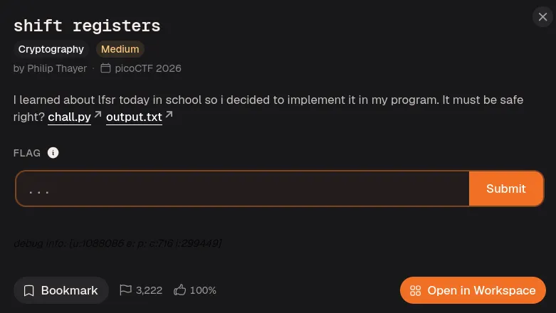
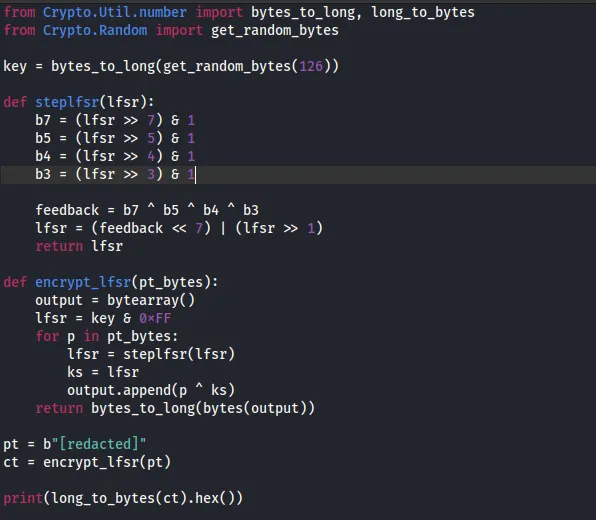
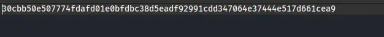
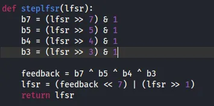
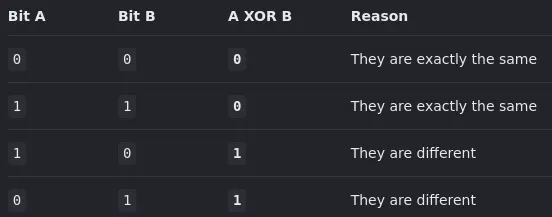
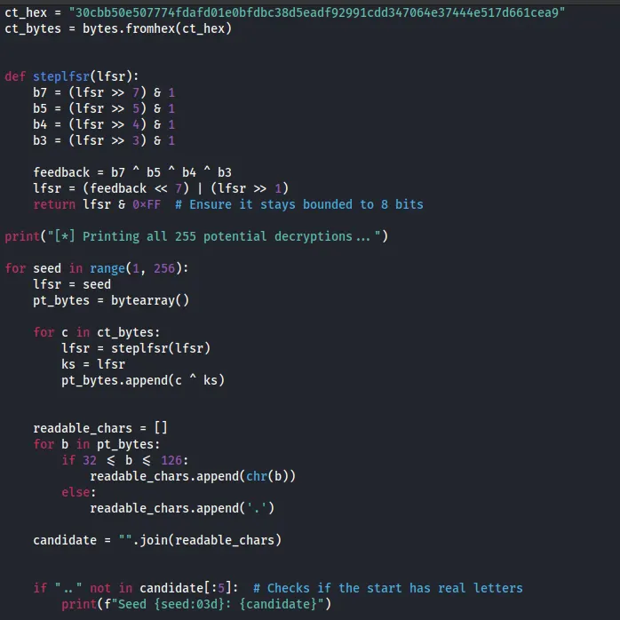
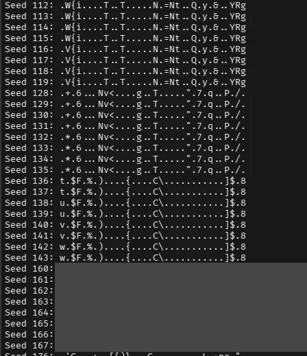

# Shift Registers: Findings Report

[](YOUR-MEDIUM-LINK)   

> **Scope:** a CTF cryptography challenge (picoCTF 2026, played through CyLab Security Academy 2026). The challenge files are `chall.py` and `output.txt`. The flag value is redacted. The step-by-step walkthrough is on Medium; this page focuses on the findings, their impact and how to fix them.

---

## Summary

The developer generated a strong 126-byte random key, then threw almost all of it away with one line: `lfsr = key & 0xFF`. That leaves an 8-bit register, so the cipher has at most 255 starting states. I decrypted the ciphertext by trying every seed and keeping the output that read as ASCII. Two more weaknesses made it worse: bit 0 of the seed never affects the output, and the register is linear, so known plaintext reveals the state at once.

| Item                  | Detail                                                  |
| --------------------- | ------------------------------------------------------- |
| **Target**            | Custom stream cipher in Python (`chall.py`)             |
| **Construction**      | 8-bit LFSR, taps at bits 7, 5, 4, 3, XORed byte by byte |
| **Ciphertext**        | 34 bytes (`output.txt`)                                 |
| **Search space**      | 255 seeds (only 128 distinct keystreams)                |
| **Recovered seed**    | 162 (163 gives the same output)                         |
| **Flag**              | Recovered (value redacted)                              |

## Attack Chain

`126-byte random key` → `key & 0xFF` → `8-bit register` → `255 possible seeds` → `Brute force with a printable-text filter` → `Seed 162` → `Plaintext flag`

---

## Findings

| # | Finding                                                                         | CWE              | Severity    |
| - | ------------------------------------------------------------------------------- | ---------------- | ----------- |
| 1 | 126-byte key truncated to 8 bits by a bitmask                                   | CWE-326          | 🔴 Critical |
| 2 | Bit 0 of the seed is shifted out before use, halving the keyspace again         | CWE-331          | 🟠 Medium   |
| 3 | A linear LFSR is used directly as the keystream, so known plaintext exposes it  | CWE-327, CWE-338 | 🔴 High     |

---

## Finding Details

### 1. Key truncated to 8 bits

**What I found:** `encrypt_lfsr()` starts with `lfsr = key & 0xFF`. The mask keeps only the lowest byte of the key, so 125 of the 126 random bytes are never used. Only 8 bits of the key ever reach the cipher.

[](images/01-challenge-page.png) [](images/02-chall-py.png) [](images/03-output-txt.png)

**Impact:** The real keyspace is 255 values, not 2^1008. A computer tests all of them in milliseconds, so the key size no longer matters.

**Fix:** Never truncate key material. Use the full key with a vetted cipher (AES-GCM or ChaCha20-Poly1305), and generate keys with `secrets` or `os.urandom`.

### 2. Bit 0 of the seed never affects the output

**What I found:** On each step the register shifts right, so bit 0 is discarded. Bit 0 is also not one of the feedback taps (7, 5, 4, 3). That means two seeds that differ only in bit 0 give the same keystream. I confirmed this for all 256 seeds. In my results, seeds 162 and 163 both decrypt to the flag.

[](images/04-steplfsr.png) [](images/07-xor-truth-table.png)

**Impact:** The effective keyspace is 128 distinct keystreams, not 255.

**Fix:** Do not design feedback logic by hand. If a design discards state bits before they affect the output, the keyspace is smaller than it looks.

### 3. Linear register used directly as the keystream

**What I found:** `ks = lfsr` uses the whole register byte as the keystream. An LFSR is linear, so it has no resistance to known-plaintext attacks. Flags start with `academy{`, so the first ciphertext byte XOR `a` gives the first keystream byte (81). Only seeds 162 and 163 produce that value.

**Impact:** Even without brute force, a short known prefix recovers the seed immediately.

**Fix:** Do not build ciphers from LFSRs. They are fine for test patterns and CRC-style checks, but not for secrecy. If you need a stream cipher, use ChaCha20 from a maintained library.

---

## Solution

I rebuilt `steplfsr` in `solve.py`, tried seeds 1 to 255, XORed the ciphertext with each keystream, and printed only the outputs that began with readable characters.

[](images/05-solve-py.png) [](images/08-run-solver-command.png) [](images/06-solver-output-redacted.png)

```python
def step(l):
    fb = ((l >> 7) ^ (l >> 5) ^ (l >> 4) ^ (l >> 3)) & 1
    return (fb << 7) | (l >> 1)

for seed in range(1, 256):
    l, out = seed, bytearray()
    for c in ct:
        l = step(l)
        out.append(c ^ l)
    if all(32 <= b <= 126 for b in out):
        print(seed, out.decode())
```

---

## My Takeaway

1. **A strong key means nothing if one line throws it away.** The weakness was a single bitmask, not the key generator.
2. **State size is the security ceiling.** An 8-bit register can never give more than 8 bits of security, whatever key goes in.
3. **Do not roll your own crypto.** A custom cipher that looks random can fall to brute force, or to a short known-plaintext prefix.

## References

- [CWE-326: Inadequate Encryption Strength](https://cwe.mitre.org/data/definitions/326.html)
- [CWE-327: Use of a Broken or Risky Cryptographic Algorithm](https://cwe.mitre.org/data/definitions/327.html)
- [CWE-331: Insufficient Entropy](https://cwe.mitre.org/data/definitions/331.html)
- [OWASP Cryptographic Storage Cheat Sheet](https://cheatsheetseries.owasp.org/cheatsheets/Cryptographic_Storage_Cheat_Sheet.html)
- [Linear-feedback shift register (Wikipedia)](https://en.wikipedia.org/wiki/Linear-feedback_shift_register)

---

*Solved in a CTF training environment. Do not test systems you do not have permission to test.*
